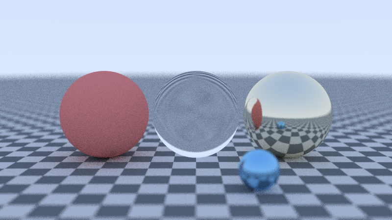

# pure-raytracer

[](https://github.com/eastyou/pure-raytracer/actions/workflows/ci.yml)
[](LICENSE)
[](pyproject.toml)

用纯 Python 从零写一个光线追踪渲染器：漫反射、金属反射、玻璃折射、柔和阴影、抗锯齿、景深，最后用 `zlib` + `struct` 手写 PNG 编码输出。**零第三方依赖**。



## 特性

- **三种材质**：Lambertian 漫反射（含棋盘格纹理）、Metal 金属（可调粗糙度）、Dielectric 玻璃（全反射 + Schlick 近似）
- **真实感细节**：多次弹射、软阴影、按像素抖动抗锯齿、薄透镜景深
- **纯手写 PNG**：IHDR / IDAT / IEND 三个块、CRC32 校验、zlib 压缩，不依赖 Pillow
- **迭代式路径追踪**：用循环代替递归，控制栈开销，深度可配
- **可复现**：固定随机种子，两次渲染字节完全一致，方便做回归测试
- **50 个单元测试**：向量运算、求交、材质、相机、PNG 结构、渲染输出
- **代码量小**：核心渲染循环不到 100 行，适合照着读、改着玩

## 安装

```bash
pip install "git+https://github.com/eastyou/pure-raytracer.git"
```

或本地开发：

```bash
git clone https://github.com/eastyou/pure-raytracer.git
cd pure-raytracer
python3 -m pip install -e .
```

不安装也能跑：`python3 -m raytracer --help`

## 使用

```bash
# 默认 480x270、8 采样，几秒钟出图
raytrace -o render.png

# 高清一点：800x450、32 采样
raytrace -o render.png -W 800 -H 450 -s 32 -d 8

# 先渲一张缩略图看看构图
raytrace -o preview.png -W 160 -H 90 -s 4
```

### 参数

| 参数 | 说明 | 默认值 |
| --- | --- | --- |
| `-o, --output` | 输出 PNG 路径 | `render.png` |
| `-W, --width` | 图片宽度（像素） | `480` |
| `-H, --height` | 图片高度（像素） | `270` |
| `-s, --samples` | 每像素采样数，越大越干净 | `8` |
| `-d, --depth` | 光线最多弹射次数 | `5` |
| `--seed` | 随机种子，固定后结果可复现 | `2026` |
| `--quiet` | 不打印进度 | 关闭 |

### 退出码

| 退出码 | 含义 |
| --- | --- |
| `0` | 渲染成功 |
| `1` | 写文件失败 |
| `2` | 参数非法 |

## 它是怎么工作的

1. **相机发射光线**：对每个像素做多次抖动采样，按视场角把屏幕坐标映射成方向向量；开启光圈时再在透镜圆盘上随机取起点，得到景深。
2. **场景求交**：球体解一元二次方程，平面解线性方程，`World` 保留最近交点。
3. **材质散射**：漫反射在法线半球内随机取方向，金属关于法线反射并叠加粗糙扰动，玻璃按斯涅尔定律折射、全反射时改为反射。
4. **迭代累积颜色**：每弹射一次就把材质衰减乘进颜色，超过深度或光线逃逸时用天空渐变收尾。
5. **写 PNG**：每行前置过滤字节 0，zlib 压缩后按块写文件，CRC32 自己算。

```
raytracer/
├── vec3.py       向量与几何运算
├── geometry.py   球、平面、场景求交
├── material.py   漫反射、金属、玻璃
├── camera.py     视场角、宽高比、景深
├── render.py     采样循环与路径追踪
├── png.py        手写 PNG 编码器
├── demo.py       示例场景
└── cli.py        命令行入口
```

## 性能

纯 Python 没有 GPU 加速，实测在 M 系列 Mac 上：

| 分辨率 | 采样 | 深度 | 耗时 |
| --- | --- | --- | --- |
| 320x180 | 8 | 5 | 约 5 秒 |
| 400x225 | 16 | 10 | 约 24 秒 |
| 800x450 | 32 | 8 | 约 3 分钟 |

想快速验证改动，用 `-W 120 -H 68 -s 4` 就够了。

## 开发与测试

```bash
python3 -m unittest discover -s tests -v
```

CI 覆盖 Python 3.9 ~ 3.13，并会实际渲染一张 32x18 的图做冒烟测试。

## License

[MIT](LICENSE) © 2026 eastyou
